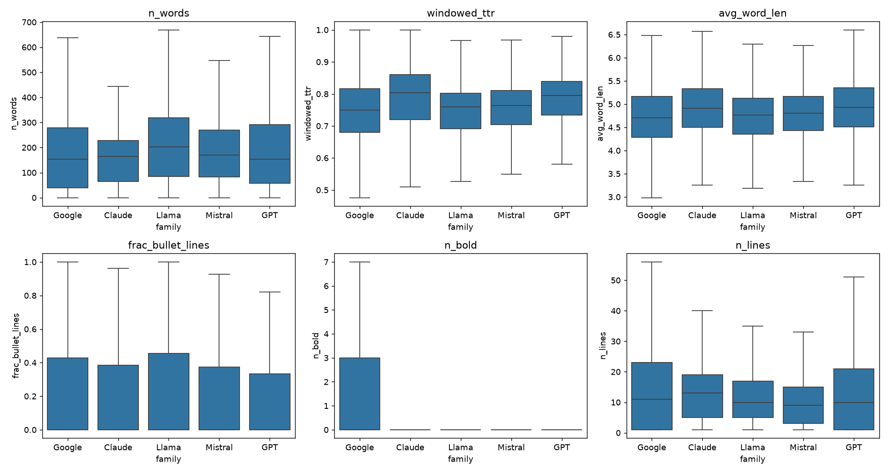
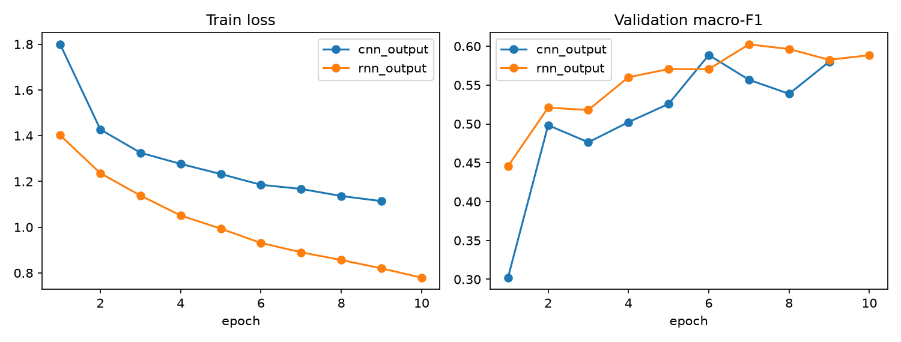
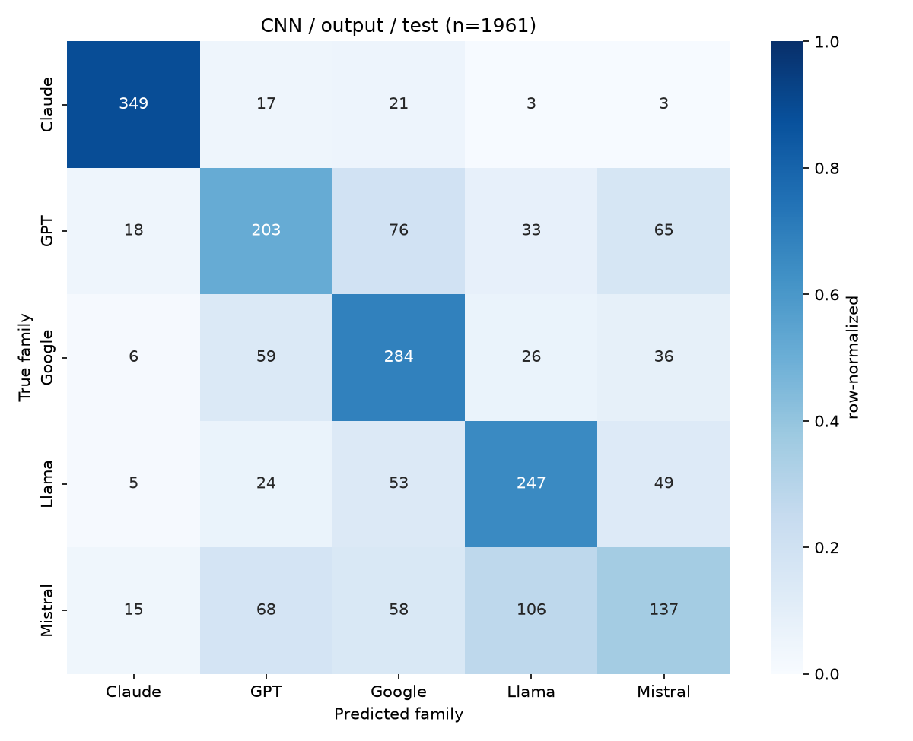
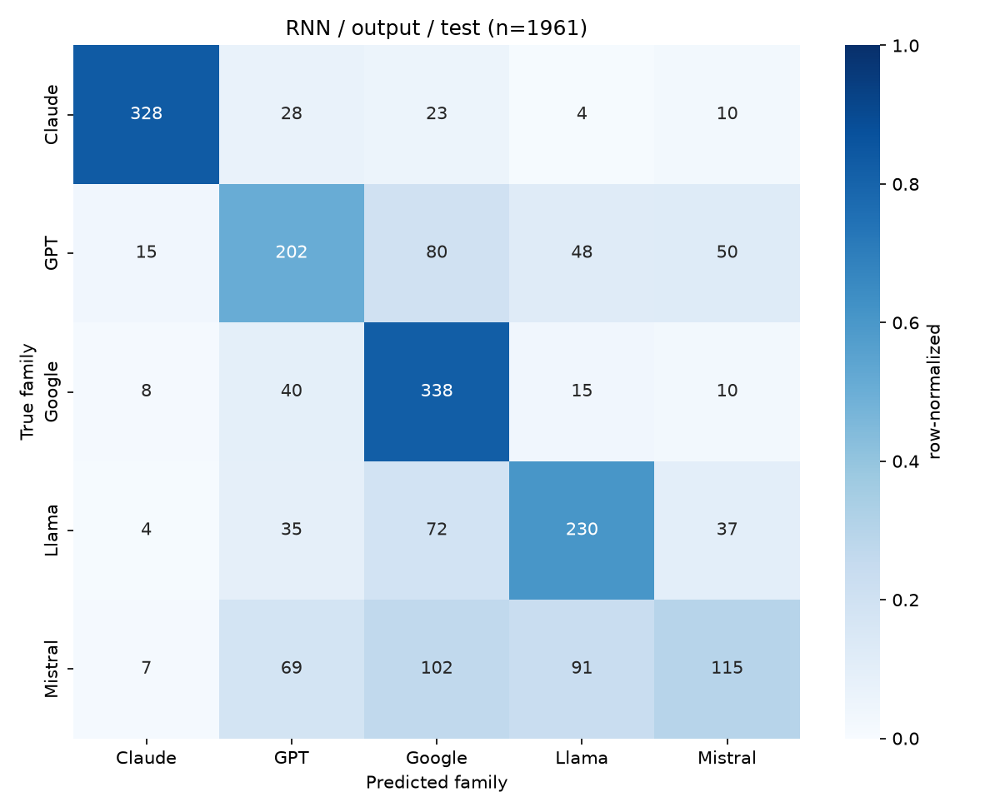

# Who Wrote It? Identifying LLMs from Their Responses
CMPSC 448 Midterm Project Report (Fall 2026)

**Team leader:** Spencer Lebiedzinski. **Team members:** Taranveer Singh
**Repository:** https://github.com/Spencer-Lebiedzinski/cmpsc448-llm-id

---

## 1. Problem Definition and Dataset Curation

### 1.1 Problem

Given the text of a chatbot response, and optionally the prompt that produced it, we predict which **LLM family** wrote it: GPT (OpenAI), Claude (Anthropic), Google (PaLM 2 / Gemini), Llama (Meta) or Mistral. This is a five-way text classification problem with balanced classes, so chance accuracy is 20%.

The motivation is attribution. As LLM-written text spreads, being able to say which model produced a passage matters for provenance, for accountability when a model's output causes harm, and for detecting when a product is silently reselling another vendor's model.

We study four research questions. RQ1 and RQ2 are required; RQ3 and RQ4 are attempted for extra credit.

- **RQ1.** Can a CNN and an RNN identify the LLM family from its output alone?
- **RQ2.** How do input only, output only, and input + output compare?
- **RQ3.** Does a classifier trained on some task domains generalize to an unseen domain?
- **RQ4.** What characteristics of the text distinguish the families?

### 1.2 Data source and collection

We use the Chatbot Arena 55k human-preference release (`lmarena-ai/arena-human-preference-55k`, Apache-2.0; Chiang et al., 2024). It contains 57,477 "battles" collected on chat.lmsys.org between roughly April 2023 and January 2024. In each battle a real user typed a prompt, two anonymous models answered it side by side, and the user voted.

We chose it for four reasons:

- The prompts are real user prompts, not synthetic ones.
- It covers many model families.
- Every prompt is answered by two models. Paired responses to the same prompt partly control for topic, which matters when the goal is to learn style and not subject matter.
- It is public and not gated, so the pipeline is reproducible with one command.

The TA-suggested `lmsys/chatbot_arena_conversations` (33k conversations) comes from the same platform but is gated on Hugging Face. Our pipeline supports it (`--source arena33k`), but it was **not used** for the results in this report.

On ethics: the data is a public research release that LMSYS filtered for personal information and moderation before publishing. We use it only for research and do not redistribute the processed CSVs; they are regenerated by the script.

### 1.3 Curation pipeline

The pipeline is `src/data/prepare_dataset.py`; details are in `data/README.md`.

1. **First turn only.** We keep the first user message and the first reply from each side of each battle, giving two examples per battle (114,954 raw examples).
2. **Model to family mapping.** Only first-party models are kept (table below). Community fine-tunes such as Vicuna, Zephyr, WizardLM and OpenHermes are dropped because their family is ambiguous: they inherit a base model from one vendor and a style from another.
3. **Filters.** We drop empty responses and responses under 20 characters, drop prompts that are under 90% ASCII (a rough English filter), and de-duplicate identical (family, output) pairs.
4. **Domain tags.** Each prompt is tagged coding, math, writing or general using keyword rules (`src/data/domains.py`), with that priority order. These tags are only used for RQ3.
5. **Balancing.** Every family is undersampled to 4,000 examples. Google is the smallest family, with 4,334 before balancing.
6. **Group split by prompt.** Prompts are hashed after lowercasing and whitespace normalization, and whole prompt groups are assigned 80/10/10 to train/val/test (seed 42). No prompt appears in two splits (verified: 17,254 unique prompts, 0 overlapping).

The group split matters for RQ2. Each prompt has two responses, usually from two different families. With a random split, an input-only model could memorize a training prompt and "recognize" it at test time, which would look like signal but would be leakage.

**Filtering funnel**

| Stage | Examples |
|---|---:|
| Raw (2 per battle) | 114,954 |
| After family filter | 70,912 |
| After empty/short filter | 69,512 |
| After ASCII filter | 69,175 |
| After de-duplication | 67,834 |
| After balancing (4,000 per family) | 20,000 |

**Models included per family** (counts after balancing)

| Family | Models |
|---|---|
| Claude | claude-2.1 (1,375), claude-instant-1 (1,044), claude-1 (995), claude-2.0 (586) |
| GPT | gpt-4-1106-preview (959), gpt-3.5-turbo-0613 (862), gpt-4-0613 (791), gpt-4-0314 (529), gpt-3.5-turbo-1106 (416), gpt-3.5-turbo-0314 (172), gpt-4-0125-preview (167), gpt-3.5-turbo-0125 (104) |
| Google | palm-2 (1,675), gemini-pro-dev-api (1,232), gemini-pro (1,093) |
| Llama | llama-2-70b-chat (1,383), llama-2-13b-chat (1,034), llama-2-7b-chat (723), codellama-34b-instruct (639), llama-13b (221) |
| Mistral | mixtral-8x7b-instruct-v0.1 (1,637), mistral-medium (1,558), mistral-7b-instruct (757), mistral-7b-instruct-v0.2 (48) |

**Class counts per split**

| Family | Train | Val | Test | All |
|---|---:|---:|---:|---:|
| Claude | 3,228 | 379 | 393 | 4,000 |
| GPT | 3,223 | 382 | 395 | 4,000 |
| Google | 3,188 | 401 | 411 | 4,000 |
| Llama | 3,196 | 426 | 378 | 4,000 |
| Mistral | 3,222 | 394 | 384 | 4,000 |
| All | 16,057 | 1,982 | 1,961 | 20,000 |

**Family by domain (heuristic tags)**

| Family | Coding | General | Math | Writing |
|---|---:|---:|---:|---:|
| Claude | 545 | 2,585 | 336 | 534 |
| GPT | 526 | 2,574 | 359 | 541 |
| Google | 516 | 2,612 | 288 | 584 |
| Llama | 536 | 2,580 | 302 | 582 |
| Mistral | 486 | 2,625 | 337 | 552 |
| All | 2,609 | 12,976 | 1,622 | 2,793 |

The domain mix is nearly identical across families, so a classifier cannot identify a family from its task distribution.

The tags have not been hand-validated, so they should be read as approximate.

**Descriptive statistics.** Figure 1 shows the distribution of six stylometric features per family. Median response length is 153 to 203 words; Llama responses are the longest and GPT and Google the shortest.



### 1.4 Limitations of the data

- **Era bias.** All models date from 2023 to early 2024. The fingerprints we learn may not transfer to current models.
- **Pooled versions.** Each family pools several models (for example GPT-3.5 and GPT-4, or PaLM 2 and Gemini Pro) whose styles differ, which makes each class heterogeneous.
- **Sampling windows.** Families were live on Arena during different periods (Gemini Pro only arrived in December 2023), so prompt topics could in principle leak family information. RQ2 tests this directly.
- **Self-identification.** A small share of responses name their vendor ("As an AI developed by OpenAI"). RQ4 measures how much this matters.
- **Heuristic labels.** The English filter and the domain tags are rule-based.

---

## 2. CNN and RNN Implementation and Training

Both models are implemented in PyTorch (`src/models/`) and share one tokenizer, one vocabulary procedure and one training loop (`src/train.py`).

### 2.1 Shared preprocessing

- **Tokenizer** (`src/data/text.py`): a regex word tokenizer with lowercasing. It deliberately keeps formatting tokens, because formatting is part of a model's fingerprint: newlines become `<nl>`, and `**`, `#` runs, triple backticks and individual punctuation marks are kept as tokens.
- **Vocabulary**: built on the training split only, minimum frequency 2, capped at 30,000 types, plus `<pad>`, `<unk>`, `<sep>` and `<nl>`.
- **Length**: sequences are truncated to 400 tokens. In `both` mode the sequence is the prompt (at most 100 tokens), then `<sep>`, then the response.

### 2.2 Text CNN

The CNN follows Kim (2014).

```
token ids (B, T)
   -> Embedding(30,000 x 128), dropout 0.5
   -> three parallel Conv1d branches: kernel width 3, 4, 5; 128 filters each; ReLU
   -> masked max-over-time pooling per branch (windows over padding are ignored)
   -> concatenate (384), dropout 0.5
   -> Linear(384 -> 5)
```

Total parameters: **4,038,917**, of which 3.84M are the embedding table.

### 2.3 BiLSTM (RNN)

```
token ids (B, T)
   -> Embedding(30,000 x 128), dropout 0.5
   -> 1-layer bidirectional LSTM, 128 hidden units per direction, over packed sequences
   -> concatenate [masked max-pool over time (256) ; final forward and backward hidden states (256)]
   -> dropout 0.5
   -> Linear(512 -> 5)
```

Total parameters: **4,106,757**. Packing the sequences means the LSTM never reads padding, and the final hidden states correspond to the true last token of each response.

### 2.4 Training details

- **Loss and optimizer**: cross-entropy, AdamW (learning rate 1e-3, weight decay 1e-4), batch size 64, gradient-norm clipping at 1.0.
- **Schedule**: up to 10 epochs, early stopping on validation macro-F1 with patience 3. The checkpoint with the best validation macro-F1 is the one evaluated on test.
- **Seeds**: the RQ1 and RQ2 runs and the RQ4 ablations were each run with three seeds (42, 43, 44); tables for those report the mean ± sample standard deviation. The RQ3 runs, per-class scores, confusion matrices and training curves are from seed 42 only.
- **Hardware**: one NVIDIA RTX 3080 (10 GB), PyTorch 2.5.1 with CUDA 12.1. On the full training set the CNN takes about 2.2 s per epoch and the BiLSTM about 9.9 s per epoch.
- **Hyperparameter search**: none. Both models use the default settings above, chosen in advance as conventional values. The numbers in this report are therefore untuned.

Figure 2 shows the training curves for the two output-only models. The CNN's best validation epoch was 6 of 9 and the BiLSTM's was 7 of 10. The BiLSTM's training loss keeps falling (to 0.78) while its validation F1 plateaus near 0.60, which is the start of overfitting; the CNN's loss falls more slowly (to 1.11) and its validation F1 is noisier from epoch to epoch.



---

## 3. Results

All numbers are on the held-out test split (1,961 examples) unless stated, from `results/summary.md` (seed 42) and `results/seed_summary.md` (three seeds). With this test size the 95% sampling interval on an accuracy near 0.62 is about ±2 points, and the seed-to-seed standard deviation is 1 to 4 points, so differences of one or two points should not be read as real.

### 3.1 RQ1: identifying the LLM from its output

| Model | Accuracy | Macro-F1 |
|---|---:|---:|
| Chance | 0.200 | 0.200 |
| Text CNN (3 seeds) | 0.625 ± 0.007 | 0.611 ± 0.018 |
| BiLSTM (3 seeds) | 0.622 ± 0.010 | 0.611 ± 0.018 |
| TF-IDF (word 1-2grams + char 3-5grams) + logistic regression | 0.630 | 0.627 |

Both neural models identify the family about 62% of the time, roughly three times chance. The CNN and the BiLSTM are indistinguishable (their per-seed accuracies range over 0.619 to 0.633 and 0.614 to 0.634), and neither beats the non-neural TF-IDF reference. On this task and data size, most of the usable signal is in local word and character n-grams, which a bag-of-n-grams model already captures.

**Per-class F1 (seed 42)**

| Model | Claude | GPT | Google | Llama | Mistral |
|---|---:|---:|---:|---:|---:|
| Text CNN | 0.89 | 0.53 | 0.63 | 0.62 | 0.41 |
| BiLSTM | 0.87 | 0.53 | 0.66 | 0.60 | 0.38 |





The difficulty is very uneven across families:

- **Claude is easy.** Both models reach F1 near 0.88, and the CNN recovers 349 of 393 Claude responses. Claude is rarely confused with anything else.
- **Mistral is hard.** Only 137 of 384 Mistral responses are classified correctly by the CNN. The largest single error is Mistral predicted as Llama (106 for the CNN, 91 for the BiLSTM); the BiLSTM also sends 102 Mistral responses to Google.
- **GPT and Google overlap.** GPT is predicted as Google 76 times (CNN) and 80 times (BiLSTM), and Google as GPT 59 and 40 times.

A plausible reading is that the open-weight families (Llama, Mistral) share a plainer, less formatted style, while Claude in this era had distinctive stock phrasing (Section 4).

### 3.2 RQ2: does the prompt help?

Test accuracy (mean ± standard deviation over three seeds for the neural models; TF-IDF is deterministic):

| Model | Input only | Output only | Input + output |
|---|---:|---:|---:|
| Text CNN | 0.200 ± 0.010 | 0.625 ± 0.007 | 0.587 ± 0.017 |
| BiLSTM | 0.216 ± 0.005 | 0.622 ± 0.010 | 0.582 ± 0.040 |
| TF-IDF + LR | 0.224 | 0.630 | 0.606 |

**(i) Input only is at chance.** From the prompt alone the CNN averages exactly 20.0%, and the BiLSTM and TF-IDF reach 21.6% and 22.4%. The sampling standard error is about 0.9 points, so this is at most a marginal effect of one or two points. The sampling-window concern from Section 1.4 does not show up as usable signal: knowing what the user asked tells the classifier essentially nothing about which family answered. This is the expected result for Arena data, where models are assigned to prompts at random, and it is only visible because of the group split by prompt.

**(ii) Adding the input does not help.** Input + output is *lower* than output alone for all three models: by about 4 points on average for the CNN and the BiLSTM, and by 2.4 points for TF-IDF. The BiLSTM's result is noisy (one seed fell to 0.537), but no model and no seed improved by adding the prompt. The likely cause is that the prompt carries no label information while consuming up to 100 of the 400 tokens and adding unrelated vocabulary.

**(iii) Why input could have worked, and why it does not.** Both responses in a battle share one prompt and usually come from different families, which caps how well any input-only model can do. The result confirms that the output-only accuracy in RQ1 comes from how the models write, not from what they were asked.

### 3.3 RQ3: cross-domain generalization

For each domain we train on the other three and evaluate the same model on test examples from the training domains (in-domain) and from the held-out domain (out-of-domain). These runs use seed 42 only. Accuracy, with macro-F1 in parentheses:

| Held-out domain | OOD test n | CNN in-domain | CNN OOD | BiLSTM in-domain | BiLSTM OOD |
|---|---:|---:|---:|---:|---:|
| Writing | 294 | 0.645 (0.638) | 0.554 (0.546) | 0.652 (0.631) | 0.527 (0.496) |
| Coding | 230 | 0.620 (0.602) | 0.587 (0.537) | 0.630 (0.630) | 0.587 (0.555) |
| Math | 145 | 0.616 (0.596) | 0.510 (0.495) | 0.626 (0.633) | 0.641 (0.639) |
| General | 1,292 | 0.576 (0.557) | 0.550 (0.546) | 0.537 (0.521) | 0.497 (0.500) |

The out-of-domain test sets are small (145 to 294 examples for three of the four domains, about ±6 to 8 points), so individual cells are noisy. The general holdout also trains on only 5,648 examples instead of about 14,000, which lowers both of its columns.

**(i) Performance usually drops on an unseen domain, but stays far above chance.** In seven of the eight model and domain pairs out-of-domain accuracy is lower, by 2 to 13 points. The one exception (BiLSTM on math) is on the smallest test set and is within noise. The worst out-of-domain result is still about 50%, two and a half times chance.

**(ii) Claude stays identifiable; Mistral does not.** Claude's out-of-domain F1 is between 0.71 and 0.88 in every holdout. Mistral is the least stable family: its out-of-domain F1 falls to 0.22 for the CNN on coding and math and to 0.09 for the BiLSTM on writing.

**(iii) The models learn a mostly general fingerprint with a task-specific component.** Retaining 50 to 59% accuracy on a domain never seen in training means most of the signal is domain-independent style. The consistent drop means some of what the models learn is tied to the task. Writing shows the largest consistent drop for both models, which fits the intuition that creative writing changes a model's surface style more than coding or factual answers do.

---

## 4. In-depth Analyses (RQ4)

### 4.1 Stylometric features

We computed 16 interpretable features per response (`src/analysis/stylometry.py`). Medians for the features with non-zero medians, and means for the sparse formatting features:

| Feature | Claude | GPT | Google | Llama | Mistral |
|---|---:|---:|---:|---:|---:|
| Words (median) | 164.5 | 153 | 154 | 203 | 170 |
| Lines (median) | 13 | 10 | 11 | 10 | 9 |
| Type-token ratio (median) | 0.595 | 0.587 | 0.526 | 0.505 | 0.550 |
| Windowed type-token ratio (median) | 0.803 | 0.794 | 0.750 | 0.760 | 0.764 |
| Average word length (median) | 4.91 | 4.93 | 4.71 | 4.76 | 4.80 |
| Bold spans (mean) | 0.01 | 0.89 | 2.07 | 0.02 | 0.12 |
| Markdown headers (mean) | 0.09 | 0.28 | 0.18 | 0.12 | 0.19 |
| Exclamation marks (mean) | 0.37 | 0.28 | 0.15 | 0.52 | 0.32 |
| Question marks (mean) | 0.21 | 0.23 | 0.27 | 0.42 | 0.27 |
| Emoji (mean) | 0.01 | 0.04 | 0.01 | 0.14 | 0.17 |
| Apology or refusal phrase (share) | 0.117 | 0.075 | 0.034 | 0.094 | 0.042 |
| Mentions a vendor or model name (share) | 0.004 | 0.008 | 0.002 | 0.005 | 0.005 |

What stands out:

- **Bold text is a Google and GPT signature.** Google averages about two bold spans per response and GPT about one; Claude and Llama almost never use bold. This is the largest single difference between families.
- **Claude and GPT have richer vocabulary.** Their type-token ratios are the highest; Llama's is the lowest, and Llama also writes the longest responses.
- **Llama is the most exclamatory and asks the most questions**, consistent with the chatty "Sure! Here's..." style of Llama-2-chat.
- **Claude refuses or apologizes most often** (11.7% of responses) and Google least (3.4%).
- **Self-identification is rare.** Under 1% of responses in any family mention a vendor or model name.

**How much does style alone explain?** A logistic regression on only these 16 features reaches **0.409 accuracy (0.401 macro-F1)**. That is twice chance, and about half of the gap between chance and the neural models (0.62). So coarse style counts carry real signal, but most of what the CNN and BiLSTM use is lexical. The largest standardized coefficients match the table: bold count is the strongest positive feature for Google (+0.90) and strongly negative for Claude (-0.71) and Llama (-0.66); type-token ratio is positive for Claude and GPT (about +0.7) and strongly negative for Llama (-1.04); line count is positive for Claude (+0.67).

### 4.2 Ablations

We retrained each model with a signal removed from the text. Test accuracy, mean ± standard deviation over three seeds:

| Input text | CNN | BiLSTM |
|---|---:|---:|
| Full output | 0.625 ± 0.007 | 0.622 ± 0.010 |
| Vendor and model names masked | 0.612 ± 0.019 | 0.633 ± 0.016 |
| Markdown and newlines stripped | 0.507 ± 0.042 | 0.555 ± 0.028 |
| Names masked and formatting stripped | 0.542 ± 0.014 | 0.556 ± 0.023 |
| First 64 tokens only | 0.524 ± 0.022 | 0.555 ± 0.004 |

- **Self-identification does not drive the results.** Masking vendor and model names changes mean accuracy by about one point in either direction, which is inside the seed spread. This is consistent with under 1% of responses containing such names. The classifiers are not simply reading "I am ChatGPT".
- **Formatting matters.** Stripping markdown markers, list bullets and line breaks costs the BiLSTM about 7 points and the CNN 8 to 12 points. In the seed-42 runs GPT is hurt most: its F1 falls from 0.53 to between 0.33 and 0.45 without formatting, which fits the finding that bold text separates GPT and Google from the rest.
- **The CNN is unstable when formatting is stripped.** Its three seeds range from 0.464 to 0.548, the widest spread of any configuration; the lowest run early-stopped with its best checkpoint at epoch 2. Its mean (0.507) sits below the run that also masks names (0.542), which removes strictly more information, but that difference is within the spread and should be read as noise.
- **Length matters.** With only the first 64 tokens, accuracy falls by about 7 points (BiLSTM) and 10 points (CNN), but 52 to 56% is still far above chance. A substantial part of the fingerprint is visible in the opening sentences.
- **The BiLSTM may be slightly more robust.** In the three ablations that remove formatting or length its mean is 1 to 5 points above the CNN's, and it is much more stable under truncation (± 0.004 vs ± 0.022). With three seeds the gaps are comparable to the spread, so this is suggestive only.

### 4.3 Signals the classifier uses

To see which words carry the signal, we fit a logistic regression on word 1-2gram TF-IDF features and list the highest-weighted n-grams per family (`results/rq4/top_ngrams.md`):

| Family | Highest-weighted n-grams |
|---|---|
| Claude | "here is", "so in", "in summary", "etc", "key", "apologize", "here are", "okay let", "me know" |
| GPT | "remember", "various", "please note", "as an", "sorry but", "certainly", "assistance", "specific" |
| Google | "it is", "be used", "variety of", "some additional", "help to", "sure that", "once you", "means that" |
| Llama | "sure here", "sure", "just an", "such as", "your question", "is not" |
| Mistral | "note", "however", "additionally", "any questions", "might", "that this" |

These are almost all function-word phrases and stock openers or closers, not topic words. Claude opens with "Here is..." and closes with "In summary" or "let me know"; GPT hedges with "please note", "certainly" and "as an [AI]"; Llama opens with "Sure, here..." and "just an [AI]"; Google prefers uncontracted "it is" and "a variety of". Mistral's top n-grams are generic connectives ("however", "additionally", "note"), which gives a concrete reason for its low F1: it has no strong stock phrases of its own, so its responses get absorbed into Llama, GPT and Google.

Taken together, the three analyses point to the same answer for RQ4. LLM families are distinguished mainly by habitual phrasing at the start and end of a response, second by formatting habits (bold, line breaks), and hardly at all by naming themselves.

_Not done: CNN filter-activation analysis, qualitative review of misclassified examples, within-family confusion between specific models, and learning curves over training-set size. The outline lists these as possible extensions._

---

## 5. Lessons and Experience Learned

**Data**

- **The split decides what the experiment means.** Because every prompt has two answers, a random split would have leaked prompts between train and test. Grouping by prompt is what makes the input-only result (chance) trustworthy, and that result in turn is what lets us say the output-only accuracy reflects style.
- **Label definition is a modeling decision.** Excluding community fine-tunes and pooling versions within a family both changed what "family" means. Pooling GPT-3.5 with GPT-4, and PaLM 2 with Gemini, probably contributes to those two classes being hard.
- **Balanced, matched data removes shortcuts.** The domain mix is the same in every family, so the task distribution cannot be used as a shortcut.

**Modeling**

- **A simple baseline is essential.** TF-IDF with logistic regression matches both neural models. Without it we would have overestimated what the CNN and BiLSTM contribute.
- **CNN versus BiLSTM.** They tie on full text. The CNN trains about four times faster per epoch; the BiLSTM has a smoother validation curve and may be slightly more robust when formatting or length is removed.
- **Single-seed results can mislead.** Our first, single-seed ablation table showed an impossible ordering and a 12-point gap between the models that shrank to under 5 once we averaged three seeds. The same configuration varied by up to 8 points across seeds.
- **What did not help.** Adding the prompt to the input did not help and cost a few points.

**Process**

- **Check that the hardware is actually used.** The first version of the training script never moved the model or the batches to the GPU, so it would have trained on CPU even with CUDA installed. After the fix the full grid of 23 training runs took under half an hour.
- **Reproducibility.** One command rebuilds the dataset, every run writes its config, history and metrics, and the summary table is generated from those files. Rebuilding the dataset on a second machine gave exactly the same split counts.
**Use of LLM assistance**

The course allows LLM assistance. An LLM assistant (Claude) was used to scaffold the code (data pipeline, models, training and evaluation scripts), to run the experiments, and to draft this report from the measured results. The team is responsible for verifying the code and every number against `results/summary.md` and the per-run metrics files, and for understanding everything submitted.

**What we would do next**

- Extend the multi-seed runs to the RQ3 holdouts and use more than three seeds.
- Tune hyperparameters, which were left at defaults.
- Add recent models and more data per family, and a transformer baseline.
- Hand-validate the domain tags, and analyze misclassified examples.
- Move from closed-set classification to calibrated open-set detection ("none of these families").

---

## References

- Chiang, W.-L., et al. (2024). *Chatbot Arena: An Open Platform for Evaluating LLMs by Human Preference.* arXiv:2403.04132.
- Kim, Y. (2014). *Convolutional Neural Networks for Sentence Classification.* EMNLP.
- Hochreiter, S., and Schmidhuber, J. (1997). *Long Short-Term Memory.* Neural Computation, 9(8).
- Dataset card: https://huggingface.co/datasets/lmarena-ai/arena-human-preference-55k
- Dataset card (not used): https://huggingface.co/datasets/lmsys/chatbot_arena_conversations

## Appendix: commands

```
python -m src.data.prepare_dataset
python -m src.train --model {cnn,rnn} --input_mode {output,input,both}
python -m src.train --model {cnn,rnn} --input_mode output --train_domains <three domains> --test_domains <fourth> --run_name <model>_output_holdout-<fourth>
python -m src.train --model {cnn,rnn} --input_mode output --ablation {mask_identity,strip_format,truncate64,"mask_identity,strip_format"}
python -m src.baselines.tfidf_lr --input_mode {output,input,both}
python -m src.analysis.stylometry
python -m src.analysis.report_extras
python -m src.eval --summarize runs
scripts\run_seeds.ps1 -Seed 43        # and -Seed 44; then:
python -m src.analysis.seed_summary
```

The full grid is also in `scripts/run_experiments.sh`. Confusion matrices for every run are in `runs/<run>/confusion_*.png`.
